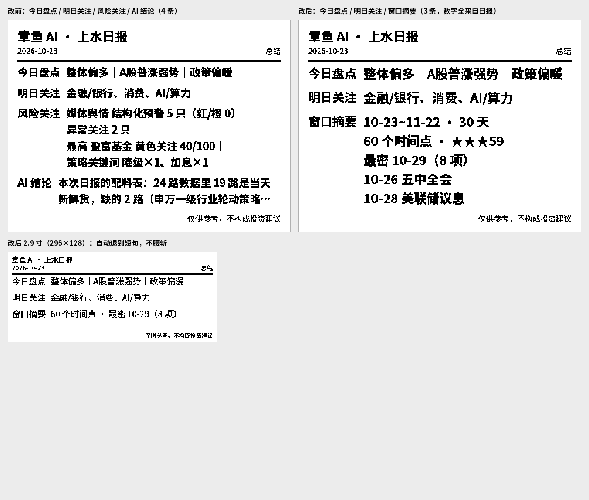

# 01-eink

本仓库用于墨水屏（e-ink）设备相关内容的接入与合并。

## 已接入内容：eMemoLog 设备仓库

从设备仓库 https://github.com/einkinner/ememolog 合并了墨水屏日历校准工具（Web Bluetooth）：

- `index.html` — 设备控制页面（蓝牙连接、同步时间、旋转屏幕、日志）
- `css/main.css` — 页面样式
- `js/main.js` — Web Bluetooth 交互逻辑（EPD 服务 `62750001-d828-918d-fb46-b6c11c675aec`、特征值 `62750002-d828-918d-fb46-b6c11c675aec`）
- `.github/workflows/static.yml` — GitHub Pages 静态部署流程
- `LICENSE` — GNU GPL v3

页面可在支持 Web Bluetooth 的浏览器中运行（桌面 Chrome/Edge、Android Chrome/Edge、iOS Bluefy），用于连接墨水屏日历设备并进行时间同步与屏幕旋转等操作。

## AI 总结推送

页面新增「AI 总结推送」区块，一键把 `001/output/latest.html`（章鱼 AI · 上水日报）的内容渲染成位图并推送到墨水屏。

| 项 | 说明 |
|---|---|
| 内容来源 | 同源抓取 `001/output/latest.html`：`总结` 栏目的 `今日盘点 / 明日关注` + `【探照安康鱼】时间节点量化分析` 的 `窗口摘要` |
| 屏上三行 | **今日盘点 / 明日关注 / 窗口摘要**（2026-10-24 起取代原来的「风险关注 / AI 结论」：那两条又长又常被截，屏上读不完） |
| 窗口摘要 | 时间窗口 · 时间点总数 · ★★★ 数量 · 最密集日 · 重点会议（按关键词挑重头戏，不是原文前两个）。每个数字都来自日报原文，只压缩不加料；小屏自动退到更短的一档整句，不腰斩 |
| 老日报兼容 | 没有「窗口摘要」表的旧日报，自动退回 `风险关注 / AI 结论` 两条 |
| 预览 | 「重新抓取并预览」重新读日报并重绘，不碰蓝牙；切换尺寸/字体/字号会直接用缓存重绘；「预览」下拉可 1×/2×/3× 放大，方便看笔画 |
| 屏幕尺寸 | 4.2 寸 400×300（默认）、2.9 寸 296×128、2.13 寸 250×122 |
| 字体 | 黑体加粗（默认）/ 宋体加粗 / 楷体加粗 / 等宽点阵，字体栈显式带各平台中文字体 |
| 字号 | 小（内容优先）/ 标准 / 大（字大优先），选中后自动记忆，刷新页面不丢 |
| 其他选项 | 旋转 180°、三色（黑白红）、推送字体样张 |
| 排版降级 | 放不下时先换同一条的整句短版 → 再截短最长一条 → 再减条数 → 最后才缩字号（10px 硬下限），保证不越界、不重叠 |



改动前后（400×300、标准字号）：旧版 4 条要吃满整个版面、字号只能压到 15px，`风险关注` 和 `AI 结论`
还得用省略号收尾；新版 3 条回到 18px，窗口摘要的 5 行全是完整信息。

### 字体看不清时怎么调

旧版正文只有 11px、常规字重、字体栈只写了 `sans-serif`，在很多系统上会落到很细的中文黑体（思源黑体 Light / 系统细体），1bpp 二值化后笔画断成虚线——这是「字体不清」的根因。现在：

| 手段 | 具体做法 |
|---|---|
| 字体栈 | `PingFang SC / 微软雅黑 / Noto Sans SC / 思源黑体 / 苹方 …`，不再让浏览器自己挑 |
| 字重 | 13px 起 `bold`；低于 13px 自动回常规字重（小字加粗会把「日/目/口」糊成实心块） |
| 字号 | 400×300 默认 15px、最大 24px；先找「一个字都不截就放得下」的最大字号，再按档位 ±偏移 |
| 二值化 | 阈值 140 → 176，避免抗锯齿灰边把笔画糊死 |
| 真机比对 | 「推送字体样张」把同一句话按不同字号 / 字重画成一张卡推到屏上，直接在设备上挑 |

样张内容：`字体样张 · W×H` + 5 行同句对比（当前档 ±几档，粗/常各一行），底部提示「在当前连接的真机上对比这一张」。

### 自测

```bash
node --test tests/ai-summary.test.js
```

用纯 JS 的假 canvas 上下文加载 `js/ai-summary.js`，覆盖：总结栏目解析、三种屏幕尺寸不越界、每行不超宽、避头尾折行、字号档位单调、1bpp 位平面打包（含行尾补齐位与红色层）、字体样张、偏好记忆。

BLE 图像协议（EPD-nRF5 系）：

```
INIT(0x01) → 等待 → WRITE_IMAGE(0x30, 黑白层) → [WRITE_IMAGE(0x30, 红色层)] → REFRESH(0x05)
```

- 报文：`[0x30][flag][data...]`，1bpp、8 像素/字节、MSB first
- 黑白层 `1`=白 `0`=黑；红色层 `0`=红 `1`=非红
- 块大小取设备 notification 上报的 `mtu=NNN` 减 2（默认 240）
- 固件上报 `rle=1` 时使用位标志编码（`bit0` 层、`bit1` 首块），否则用 `0x0F/0x00` + `0xF0` 续块标志

> 若连接后设备未上报 `mtu=`，日志会提示「可能是该固件不支持图像推送」。仅做时间同步的日历固件可能没有 `0x30` 指令。
