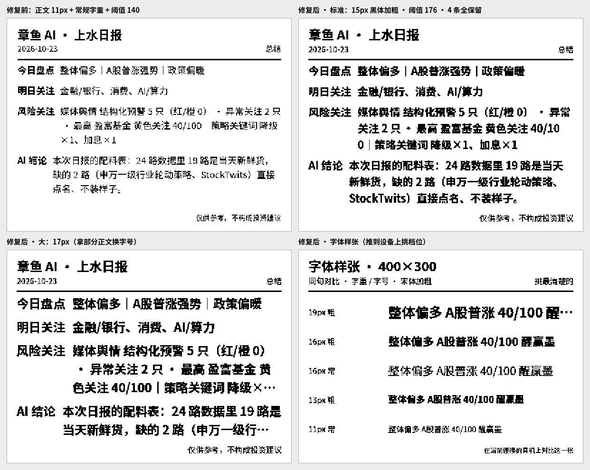

# 墨水屏卡片「字体不清」调整说明

> 当前卡片标题：**章鱼 AI.每日研报**；内容来自仓库 007 的 AI 多空概率、热点话题、风险点、机会点。



图片记录早期总结卡的字体修复过程；文字内容已切换为 007 四栏目，但下面的字体、字号与 1bpp 结论仍然适用。

## 1. 字体不清的根因

| 序号 | 根因 | 说明 |
|---:|---|---|
| 01 | 正文字号太小 | 早期 400×300 正文只有 11px；1bpp 下汉字细笔画不足 1 像素，容易断线。 |
| 02 | 只用常规字重 | 细体横画在二值化后容易消失。 |
| 03 | 字体栈只有 `sans-serif` | 不同系统可能落到很细的中文字体，宽度也不稳定。 |
| 04 | 二值化阈值偏低 | 抗锯齿灰边处理不当会让笔画断裂或字腔糊死。 |
| 05 | 按字数硬截断 | 英文、百分比、热点标题和风险句会被拦腰切断。 |

## 2. 当前处理

| 项 | 当前实现 |
|---|---|
| 字号 | 400×300 从可读字号开始自动寻找最大完整排版；正文硬下限 10px |
| 字重 | 13px 起 bold；13px 以下自动回常规，避免「日/目/口」糊成实心块 |
| 字体栈 | `PingFang SC / Microsoft YaHei / Noto Sans SC / Source Han Sans SC / Heiti SC / WenQuanYi Micro Hei`，另有宋体、楷体、等宽点阵 |
| 二值化 | 阈值 176；位平面行尾补齐保持白色 |
| 折行 | 中文逐字排、英文/数字/百分比整段不拆、标点避头尾 |
| 四栏 | AI 多空概率 / 热点话题 / 风险点 / 机会点在三种尺寸上全部保留 |
| 小屏降级 | 每栏都带完整短版候选：完整含标注 → 去情绪权重 → 减少条数 → 标点处短标题；优先换短句，不腰斩事实 |

## 3. 页面调节

| 控件 | 作用 |
|---|---|
| 字体 | 黑体加粗 / 宋体加粗 / 楷体加粗 / 等宽点阵 |
| 字号 | 小（内容优先）/ 标准 / 大（字大优先） |
| 预览 | 1× / 2× / 3×；只放大网页预览，不改变设备位图 |
| 推送字体样张 | 把同一句话按不同字号和字重画到真机；未连接时只生成网页预览 |
| 记忆 | 屏幕尺寸、字体、字号和预览倍数写入 `localStorage` |

## 4. 真机验证

1. 用支持 Web Bluetooth 的浏览器打开页面。
2. 连接设备，点击「推送字体样张」。
3. 选择真机上最清楚的字体 / 字号组合。
4. 点击「重新读取 007 并预览」，确认四栏。
5. 点击「推送最新每日研报」。

## 5. 自测

```bash
node --test tests/*.test.js
```

测试覆盖真实 007 JSON、四栏目白名单、标题、三种屏幕尺寸、完整短句降级、边界、字号单调性、1bpp 黑白 / 红色位平面、字体样张，以及每日 09:15 / 17:15 两次自动推送调度。
